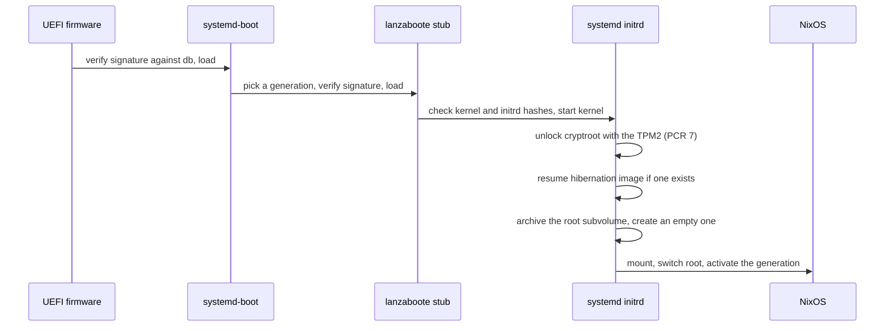

# Boot chain

## Overview

The workstation boots through UEFI Secure Boot with its own keys, unlocks the encrypted root
container with the TPM, then either resumes a hibernated session or rolls the root filesystem
back to an empty state. Each stage verifies or unlocks the next one.



### Secure Boot

The firmware runs in user mode with a custom Platform Key (PK), Key Exchange Key (KEK) and
signature database (db), generated by sbctl. The Microsoft certificates are enrolled next to them,
so the Windows boot manager and option ROMs signed by Microsoft still load. The private keys live in
`/var/lib/sbctl`, persisted outside the rolled-back root and never committed.

lanzaboote replaces the systemd-boot installer of NixOS. At every activation it signs
systemd-boot and writes one stub per generation into `EFI/Linux/`. A stub is a small signed
Unified Kernel Image (UKI) that carries the kernel command line and the hashes of the kernel and
the initrd, stored unsigned and shared between generations in `EFI/nixos/`. The firmware checks
the signature of the stub; the stub checks the hashes before starting the kernel. A full UKI per
generation would weigh more than 170 MiB; the stubs keep ten generations well inside the 4 GiB
EFI System Partition (ESP).

lanzaboote never writes the firmware boot entries. The `Linux Boot Manager` entry is created once,
at installation, with `efibootmgr`.

### TPM2 unlock

The root container is LUKS2. Its TPM2 key slot is sealed against PCR 7, which measures the Secure
Boot state and the keys that verified each loaded image. The key unseals as long as Secure Boot
stays enabled with the same key databases, whatever the generation, the kernel or the command
line. PCR 7 is a deliberately light seal: unlock stability ranks above seal strength. A stronger
policy is a Phase 8 subject of the migration roadmap.

Every boot measures more than PCR 7. The firmware measures itself, its configuration, the boot
entries and each PE image it starts; systemd-boot adds SMBIOS data and `loader.conf`; the
lanzaboote stub measures its kernel, `os-release`, command line and initrd into PCR 11, as
systemd-stub does for a UKI, and the credentials it finds on the ESP into PCR 12; the EFI stub of
the kernel measures the command line and the initrd it received into PCR 9. The PCR 11 value of a
generation can be computed outside the TPM from the files of the generation: the `os-release`
section is not the one of the system but a three-key file that lanzaboote writes, with the
bootspec label, the generation number and the day the profile link was created. `bootctl status`
lists "Measures kernel+command line+sysexts" and "Picks up credentials" as unsupported by the
stub, because lanzastub sets only the first bit of `StubFeatures`; the measurements happen
anyway. With Secure Boot enabled, the stub ignores a command line passed by systemd-boot, so the
menu editor (`editor true` in `loader.conf`) cannot change the kernel command line. The table
[PCR measurements](#pcr-measurements) lists what each PCR holds on this machine.

The passphrase and the recovery key slots remain as fallbacks. The initrd asks for them only when
the TPM2 unseal fails. The enrollment of these slots is a manual procedure, described in
[LUKS enrollment](../operations/luks-enrollment.md), because each slot produces a secret bound to
the machine.

### Firmware code lock

PCR 0 holds the firmware code, so it is the only PCR that sees a reflashed or downgraded firmware
before that firmware measures everything else. It changes with every firmware update, so a seal
on its raw value would fail after each one. systemd-pcrlock replaces the raw value with a policy
stored in a TPM2 NV index: the TPM2 slot is bound to the index, and the index holds an OR of the
PCR 0 values allowed. Rewriting the index changes the allowed values without touching the LUKS
header, and removes the values it no longer lists, so an older firmware stops unsealing once the
new one is locked.

`systemd-pcrlock-firmware-code` copies the PCR 0 records of the current event log into
`/var/lib/pcrlock.d/250-firmware-code-early.pcrlock.d/generated.pcrlock` at every boot, and
`systemd-pcrlock-make-policy` rewrites the NV index from the `.pcrlock` components when the
prediction changed. The PCR 0 separator component comes from systemd through `/etc/pcrlock.d`.
`pcrlock-make-policy` holds the arguments of the policy, shared by the unit and the manual
procedures: `--strict=true` makes it fail when PCR 0 cannot be predicted, instead of leaving PCR 0
out of the policy, and the PCR list keeps the other PCRs out of it. A second variant placed next
to `generated.pcrlock` before a firmware update makes the policy accept the current and the next
firmware during the update boot; once the new firmware runs, removing the variant locks the policy
to it alone.

Writing the NV index requires the current PCR state to satisfy the policy it holds, or the
recovery PIN. The PIN is generated when the index is created and shown once; a copy is sealed to
the policy of the index, so that copy no longer opens once the policy is out of date. After a
boot on a firmware that the policy does not allow, the recovery key opens the container, the
policy update of every boot fails, and the index keeps the previous firmware: a firmware change
is never accepted without a human decision. Accepting the running firmware takes the recovery
PIN. The unit never creates the index: it is skipped until `/var/lib/systemd/pcrlock.json`
exists, so the index and its PIN are created by hand.

The policy file `/var/lib/systemd/pcrlock.json` holds the predicted values, the NV index handle
and the sealed PIN. A copy is written to the ESP as a credential, since the initrd cannot read
`/var` before the unlock; the stub measures it into PCR 12, which therefore changes whenever the
policy changes.

The two units are the upstream early-boot oneshots of systemd and stay unconfined: they read the
firmware event log and files owned by root, and a firmware able to forge the log already
controls every measurement. They run once per boot, before `sysinit.target`, without network.

### Boot splash

Plymouth starts in the initrd and shows the NixOS logo turning on the bordeaux background of the
desktop palette until the login screen. The kernel, udev and the initrd print errors only, and
Escape during the splash shows the messages; `journalctl -b` keeps all of them. When the TPM2
unseal fails, the passphrase prompt appears inside the splash. The keymap and the console palette
are copied into the initrd (`console.earlySetup`), so the passphrase and the recovery key are typed
with the French layout, and the emergency shell uses the same colours as the virtual consoles.

Changing the splash, the initrd or the kernel command line changes the measurements of the boot
images, never PCR 7, which records only the Secure Boot state and keys, so the TPM2 unlock is not
affected.

### Resume and root rollback

The initrd runs `systemd-hibernate-resume` first. When the system hibernated, systemd recorded
the location of the image in the `HibernateLocation` EFI variable, so no `resume=` parameter or
swapfile offset is declared. A successful resume replaces the running kernel with the saved one:
the rest of the initrd never runs and the session continues untouched.

Without an image, `rollback-root` runs before the root is mounted. It moves the `@root` subvolume
to `old_roots/<timestamp>`, creates an empty `@root`, and deletes archived roots older than
30 days. The order is enforced by `After=systemd-hibernate-resume.service`: rolling the root back
before a resume would corrupt the hibernated session.

### Windows

Windows lives on its own disk with its own ESP and is started from the firmware boot menu.
BitLocker seals its own key with the TPM: any change to the Secure Boot databases makes Windows ask
for its recovery key once, then reseal.

## How to verify the boot chain

1. Check that Secure Boot is enabled in user mode and list the firmware boot entries.

   ```bash
   sudo bootctl status
   ```

   ```text
   Secure Boot: enabled (user)
   ```

2. Check the signatures on the ESP.

   ```bash
   sudo sbctl verify
   ```

   Every file under `EFI/BOOT`, `EFI/systemd` and `EFI/Linux` is reported as signed. The kernel
   files under `EFI/nixos` are reported as not signed: the hash embedded in each signed stub
   protects them.

3. Check the key slots of the root container.

   ```bash
   sudo cryptsetup luksDump /dev/disk/by-partlabel/disk-main-luks
   ```

   The `Tokens` section lists one `systemd-tpm2` token bound to PCR 7 and one
   `systemd-recovery` token.

## How to boot a previous generation

1. Power on the machine and press an arrow key while the boot menu is shown. The timeout is 1 s.
2. Select an older `NixOS` generation and press Enter.
3. Fix the configuration and apply it again. To return to the generation that precedes the
   current one without a fix, activate it and make it the boot default.

   ```bash
   sudo nixos-rebuild switch --rollback
   ```

## How to restore Secure Boot after a firmware reset

Blast radius: the firmware key databases are rewritten. The TPM2 slot of the root container stops
unsealing, and Windows asks for its BitLocker recovery key once. Rollback path: the same keys are
enrolled again; nothing is lost while the recovery keys are at hand.

Prerequisites: the LUKS recovery key and the BitLocker recovery key are available.

1. Check that the firmware is in setup mode: `Setup Mode` is reported as enabled.

   ```bash
   sudo sbctl status
   ```

2. Enroll the persisted keys together with the Microsoft certificates.

   ```bash
   sudo sbctl enroll-keys --microsoft
   ```

3. Reboot, enable Secure Boot in the firmware setup, and boot NixOS. Type the LUKS recovery key at
   the passphrase prompt.
4. Seal the TPM2 slot again against the new PCR 7 value, following the failed unseal procedure of
   [LUKS enrollment](../operations/luks-enrollment.md#how-to-recover-from-a-failed-tpm2-unseal).
5. Boot Windows once and type its BitLocker recovery key.

## Reference

### EFI System Partition

| Path | Content | Signed |
| --- | --- | --- |
| `EFI/systemd/systemd-bootx64.efi` | systemd-boot | Yes |
| `EFI/BOOT/BOOTX64.EFI` | Copy of systemd-boot at the fallback path, entry `UEFI OS` | Yes |
| `EFI/Linux/nixos-generation-<n>-<hash>.efi` | lanzaboote stub of generation `<n>` | Yes |
| `EFI/nixos/` | Kernels and initrds shared between generations | No, hashed by the stubs |
| `loader/loader.conf` | Menu timeout and default entry | No |
| `loader/credentials/` | `nvpcr-anchor` credential used by systemd for NV-index PCRs, `pcrlock.<entry-token>.cred` copy of the pcrlock policy | No |

`<n>` is the generation number. `<hash>` identifies the stub content. `<entry-token>` is the boot
entry token of the installation, the machine ID here.

### Firmware boot entries

| Entry | Points to | Written by |
| --- | --- | --- |
| `Linux Boot Manager` | `EFI/systemd/systemd-bootx64.efi` on the Linux ESP | `efibootmgr` at installation |
| `UEFI OS` | `EFI/BOOT/BOOTX64.EFI` on the Linux ESP | Firmware, automatically |
| `Windows Boot Manager` | `EFI/Microsoft/Boot/bootmgfw.efi` on the Windows ESP | Windows |

### Root container

| Property | Value |
| --- | --- |
| Partition label | `disk-main-luks` |
| Mapping | `/dev/mapper/cryptroot` |
| Format | LUKS2, cryptsetup defaults, 4096-byte sectors |
| Options | `allowDiscards`, `bypassWorkqueues`, `tpm2-device=auto` |
| Key slots | Passphrase, recovery key, TPM2 sealed against PCR 7 |
| Header backup | Kept outside the machine |

### PCR measurements

Measured on 2026-11-04, generation 79, with `systemd-pcrlock log`. "Predictable" means that the
next value can be computed before the reboot.

| PCR | Measured by | Content on hephaestus | Changes when | Predictable |
| --- | --- | --- | --- | --- |
| 0 | Firmware | S-CRTM version, firmware volume `FV_MAIN` | Firmware update | No, only from the new firmware |
| 1 | Firmware, systemd-boot | SMBIOS tables, `BootOrder` and `Boot####` variables, SMBIOS system, baseboard and OEM records | Boot order or boot entries change, firmware update | Partly: the firmware digests of `Boot####` do not match their content |
| 2 | Firmware | Separator only, no option ROM | A device with a UEFI option ROM is present at boot | Yes, constant |
| 3 | Firmware | Separator only | Option ROM configuration | Yes, constant |
| 4 | Firmware | Boot option action, Authenticode digests of systemd-boot and of the stub of the generation | Every generation, systemd-boot update | Yes, from the signed PE files |
| 5 | Firmware, systemd-boot | GPT header, `loader.conf`, `ExitBootServices` | Repartitioning, `loader.conf` settings | Yes; `loader.conf` stays `default nixos-*` across generations |
| 6 | Firmware | Separator only | Platform-specific events | Yes, constant |
| 7 | Firmware | `SecureBoot`, PK, KEK, db, dbx, and the db authority that verified the first image | db or dbx update, key change, an image verified by another db certificate | Yes for the own keys |
| 8 | Nothing | Empty, used by GRUB only | Never | Yes, zero |
| 9 | Kernel EFI stub | Command line in UTF-16 with its terminating null, initrd followed by the credential archive | Every generation, credential change | Yes, with the credential archive |
| 10 | Kernel, IMA | `boot_aggregate` and the IMA log, kept apart from the firmware log | Every boot | No |
| 11 | lanzaboote stub | Name and content of `.linux`, `.osrel`, `.cmdline`, `.initrd` | Every generation, even an identical system, through `.osrel` | Yes, verified: recomputed from the generation files |
| 12 | lanzaboote stub | Archive of the global credentials: the `nvpcr-anchor` credential | Credential change | Yes, from the ESP |
| 13 to 16, 23 | Nothing | Empty: no system extension, no shim, no system identity measurement | When such a feature is enabled | Yes, zero |

The `nvpcr-anchor` credential dates from the installation. It is the anchor scheme of systemd
before version 262, a secret sealed against PCR 11. The log holds no `nvpcr-init` event in PCR 9
and no measurement from user space, so no NV-index PCR is initialized.

### Initrd ordering

| Unit | Runs | Effect |
| --- | --- | --- |
| `systemd-cryptsetup@cryptroot.service` | First | Unlocks the container |
| `systemd-hibernate-resume.service` | After the unlock | Resumes the image named by `HibernateLocation`, if any |
| `rollback-root.service` | After the resume attempt, before `sysroot.mount` | Archives `@root` and creates an empty one |
| `sysroot.mount` | Last | Mounts the new root |

### Options

| Option | Default | Description |
| --- | --- | --- |
| `custom.secureBoot.enable` | `false` | Signs the boot chain with lanzaboote, keeps 10 generations |
| `custom.secureBoot.pkiBundle` | `/var/lib/sbctl` | Directory of the enrolled keys, persisted |
| `custom.luks.tpm2Unlock` | `false` | Adds `tpm2-device=auto` to the crypttab entry of the container |
| `custom.luks.name` | `cryptroot` | Name of the LUKS mapping declared by disko |
| `custom.pcrlock.enable` | `false` | Keeps the systemd-pcrlock policy locked to the firmware code at every boot, provides `pcrlock-make-policy` |
| `custom.pcrlock.pcrs` | `[ 0 ]` | PCRs of the policy; the policy update fails when one cannot be predicted |
| `custom.bootSplash.enable` | `false` | Plymouth splash with the Stylix theme, quiet boot, console palette and keymap in the initrd |
| `custom.rootRollback.enable` | `false` | Installs `rollback-root.service` in the initrd |
| `custom.rootRollback.device` | None | Unlocked device holding the Btrfs filesystem |
| `custom.rootRollback.subvolume` | `@root` | Subvolume mounted on `/` |
| `custom.rootRollback.retentionDays` | `30` | Age after which an archived root is deleted |

### Upstream documentation

| Subject | Link |
| --- | --- |
| lanzaboote | <https://github.com/nix-community/lanzaboote> |
| Unified Kernel Image | <https://uapi-group.org/specifications/specs/unified_kernel_image/> |
| Boot Loader Specification | <https://uapi-group.org/specifications/specs/boot_loader_specification/> |
| PCR registry | <https://uapi-group.org/specifications/specs/linux_tpm_pcr_registry/> |
| `systemd-cryptenroll` | <https://www.freedesktop.org/software/systemd/man/latest/systemd-cryptenroll.html> |
| `systemd-hibernate-resume` | <https://www.freedesktop.org/software/systemd/man/latest/systemd-hibernate-resume.html> |
| `boot.initrd.luks.devices` | <https://search.nixos.org/options?channel=unstable&query=boot.initrd.luks.devices> |
| `boot.initrd.systemd` | <https://search.nixos.org/options?channel=unstable&query=boot.initrd.systemd> |
