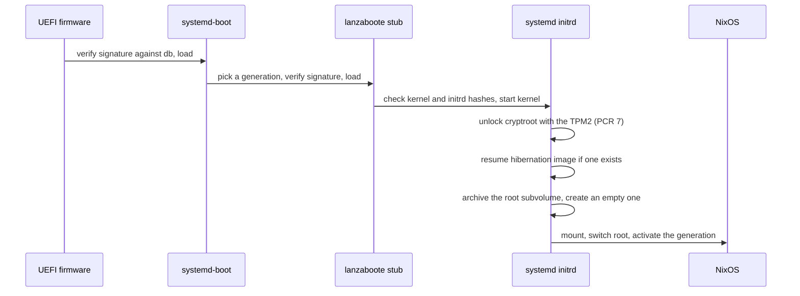

# Boot chain

## Overview

The workstation boots through UEFI Secure Boot with its own keys, unlocks the encrypted root
container with the TPM, then either resumes a hibernated session or rolls the root filesystem
back to an empty state. Each stage verifies or unlocks the next one.



### Secure Boot

The firmware runs in user mode with a custom Platform Key (PK), Key Exchange Key (KEK) and
signature database (db), generated by sbctl. The Microsoft certificates are enrolled next to them,
so the Windows boot manager and option ROMs signed by Microsoft still load. The private keys live in
`/var/lib/sbctl`, persisted outside the rolled-back root and never committed.

lanzaboote replaces the systemd-boot installer of NixOS. At every activation it signs
systemd-boot and writes one stub per generation into `EFI/Linux/`. A stub is a small signed
Unified Kernel Image (UKI) that carries the kernel command line and the hashes of the kernel and
the initrd, stored unsigned and shared between generations in `EFI/nixos/`. The firmware checks
the signature of the stub; the stub checks the hashes before starting the kernel. A full UKI per
generation would weigh more than 170 MiB; the stubs keep ten generations well inside the 4 GiB
EFI System Partition (ESP).

lanzaboote never writes the firmware boot entries. The `Linux Boot Manager` entry is created once,
at installation, with `efibootmgr`.

### TPM2 unlock

The root container is LUKS2. Its TPM2 key slot is sealed against PCR 7, which measures the Secure
Boot state and the keys that verified each loaded image. The key unseals as long as Secure Boot
stays enabled with the same key databases, whatever the generation, the kernel or the command
line. PCR 7 is a deliberately light seal: unlock stability ranks above seal strength. A stronger
policy is a Phase 8 subject of the migration roadmap.

The passphrase and the recovery key slots remain as fallbacks. The initrd asks for them only when
the TPM2 unseal fails. The enrollment of these slots is a manual procedure, described in
[LUKS enrollment](../operations/luks-enrollment.md), because each slot produces a secret bound to
the machine.

### Resume and root rollback

The initrd runs `systemd-hibernate-resume` first. When the system hibernated, systemd recorded
the location of the image in the `HibernateLocation` EFI variable, so no `resume=` parameter or
swapfile offset is declared. A successful resume replaces the running kernel with the saved one:
the rest of the initrd never runs and the session continues untouched.

Without an image, `rollback-root` runs before the root is mounted. It moves the `@root` subvolume
to `old_roots/<timestamp>`, creates an empty `@root`, and deletes archived roots older than
30 days. The order is enforced by `After=systemd-hibernate-resume.service`: rolling the root back
before a resume would corrupt the hibernated session.

### Windows

Windows lives on its own disk with its own ESP and is started from the firmware boot menu.
BitLocker seals its own key with the TPM: any change to the Secure Boot databases makes Windows ask
for its recovery key once, then reseal.

## How to verify the boot chain

1. Check that Secure Boot is enabled in user mode and list the firmware boot entries.

   ```bash
   sudo bootctl status
   ```

   ```text
   Secure Boot: enabled (user)
   ```

2. Check the signatures on the ESP.

   ```bash
   sudo sbctl verify
   ```

   Every file under `EFI/BOOT`, `EFI/systemd` and `EFI/Linux` is reported as signed. The kernel
   files under `EFI/nixos` are reported as not signed: the hash embedded in each signed stub
   protects them.

3. Check the key slots of the root container.

   ```bash
   sudo cryptsetup luksDump /dev/disk/by-partlabel/disk-main-luks
   ```

   The `Tokens` section lists one `systemd-tpm2` token bound to PCR 7 and one
   `systemd-recovery` token.

## How to boot a previous generation

1. Power on the machine and press an arrow key while the boot menu is shown. The timeout is 1 s.
2. Select an older `NixOS` generation and press Enter.
3. Fix the configuration and apply it again. To return to the generation that precedes the
   current one without a fix, activate it and make it the boot default.

   ```bash
   sudo nixos-rebuild switch --rollback
   ```

## How to restore Secure Boot after a firmware reset

Blast radius: the firmware key databases are rewritten. The TPM2 slot of the root container stops
unsealing, and Windows asks for its BitLocker recovery key once. Rollback path: the same keys are
enrolled again; nothing is lost while the recovery keys are at hand.

Prerequisites: the LUKS recovery key and the BitLocker recovery key are available.

1. Check that the firmware is in setup mode: `Setup Mode` is reported as enabled.

   ```bash
   sudo sbctl status
   ```

2. Enroll the persisted keys together with the Microsoft certificates.

   ```bash
   sudo sbctl enroll-keys --microsoft
   ```

3. Reboot, enable Secure Boot in the firmware setup, and boot NixOS. Type the LUKS recovery key at
   the passphrase prompt.
4. Seal the TPM2 slot again against the new PCR 7 value, following the failed unseal procedure of
   [LUKS enrollment](../operations/luks-enrollment.md#how-to-recover-from-a-failed-tpm2-unseal).
5. Boot Windows once and type its BitLocker recovery key.

## Reference

### EFI System Partition

| Path | Content | Signed |
| --- | --- | --- |
| `EFI/systemd/systemd-bootx64.efi` | systemd-boot | Yes |
| `EFI/BOOT/BOOTX64.EFI` | Copy of systemd-boot at the fallback path, entry `UEFI OS` | Yes |
| `EFI/Linux/nixos-generation-<n>-<hash>.efi` | lanzaboote stub of generation `<n>` | Yes |
| `EFI/nixos/` | Kernels and initrds shared between generations | No, hashed by the stubs |
| `loader/loader.conf` | Menu timeout and default entry | No |
| `loader/credentials/` | `nvpcr-anchor` credential used by systemd for NV-index PCRs | No |

`<n>` is the generation number. `<hash>` identifies the stub content.

### Firmware boot entries

| Entry | Points to | Written by |
| --- | --- | --- |
| `Linux Boot Manager` | `EFI/systemd/systemd-bootx64.efi` on the Linux ESP | `efibootmgr` at installation |
| `UEFI OS` | `EFI/BOOT/BOOTX64.EFI` on the Linux ESP | Firmware, automatically |
| `Windows Boot Manager` | `EFI/Microsoft/Boot/bootmgfw.efi` on the Windows ESP | Windows |

### Root container

| Property | Value |
| --- | --- |
| Partition label | `disk-main-luks` |
| Mapping | `/dev/mapper/cryptroot` |
| Format | LUKS2, cryptsetup defaults, 4096-byte sectors |
| Options | `allowDiscards`, `bypassWorkqueues`, `tpm2-device=auto` |
| Key slots | Passphrase, recovery key, TPM2 sealed against PCR 7 |
| Header backup | Kept outside the machine |

### Initrd ordering

| Unit | Runs | Effect |
| --- | --- | --- |
| `systemd-cryptsetup@cryptroot.service` | First | Unlocks the container |
| `systemd-hibernate-resume.service` | After the unlock | Resumes the image named by `HibernateLocation`, if any |
| `rollback-root.service` | After the resume attempt, before `sysroot.mount` | Archives `@root` and creates an empty one |
| `sysroot.mount` | Last | Mounts the new root |

### Options

| Option | Default | Description |
| --- | --- | --- |
| `custom.secureBoot.enable` | `false` | Signs the boot chain with lanzaboote, keeps 10 generations |
| `custom.secureBoot.pkiBundle` | `/var/lib/sbctl` | Directory of the enrolled keys, persisted |
| `custom.luks.tpm2Unlock` | `false` | Adds `tpm2-device=auto` to the crypttab entry of the container |
| `custom.luks.name` | `cryptroot` | Name of the LUKS mapping declared by disko |
| `custom.rootRollback.enable` | `false` | Installs `rollback-root.service` in the initrd |
| `custom.rootRollback.device` | None | Unlocked device holding the Btrfs filesystem |
| `custom.rootRollback.subvolume` | `@root` | Subvolume mounted on `/` |
| `custom.rootRollback.retentionDays` | `30` | Age after which an archived root is deleted |

### Upstream documentation

| Subject | Link |
| --- | --- |
| lanzaboote | <https://github.com/nix-community/lanzaboote> |
| Unified Kernel Image | <https://uapi-group.org/specifications/specs/unified_kernel_image/> |
| Boot Loader Specification | <https://uapi-group.org/specifications/specs/boot_loader_specification/> |
| PCR registry | <https://uapi-group.org/specifications/specs/linux_tpm_pcr_registry/> |
| `systemd-cryptenroll` | <https://www.freedesktop.org/software/systemd/man/latest/systemd-cryptenroll.html> |
| `systemd-hibernate-resume` | <https://www.freedesktop.org/software/systemd/man/latest/systemd-hibernate-resume.html> |
| `boot.initrd.luks.devices` | <https://search.nixos.org/options?channel=unstable&query=boot.initrd.luks.devices> |
| `boot.initrd.systemd` | <https://search.nixos.org/options?channel=unstable&query=boot.initrd.systemd> |
