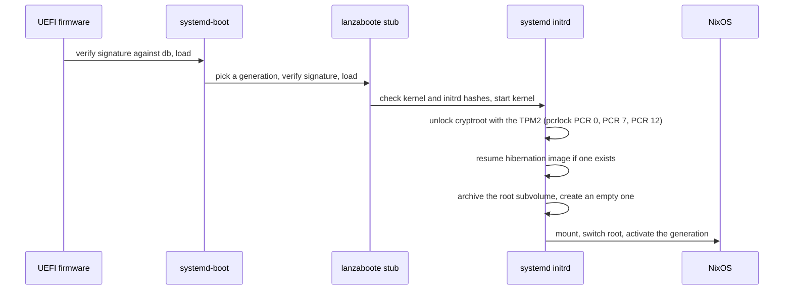

# Boot chain

## Overview

The workstation boots through UEFI Secure Boot with its own keys, unlocks the encrypted root
container with the TPM, then either resumes a hibernated session or rolls the root filesystem
back to an empty state. Each stage verifies or unlocks the next one.



### Secure Boot

The firmware runs in user mode with a custom Platform Key (PK), Key Exchange Key (KEK) and
signature database (db), generated by sbctl. The Microsoft certificates are enrolled next to them,
so the Windows boot manager and option ROMs signed by Microsoft still load. The keys live in
`/var/lib/sbctl`, persisted outside the rolled-back root and never committed.

The private keys are stored as systemd credentials sealed by the TPM to PCR 15, which holds the
measurement of the volume key of the root container. `secure-boot-keys seal` writes one
`<key>.key.cred` next to each `<key>.key`; once the plain files are removed, the disk holds no
usable private key. The install hook of the boot loader decrypts the keys into
`/run/secure-boot-keys`, a directory in memory, mode `0700`, runs lanzaboote with the db key from
there, then removes it, even when the install fails. The same directory carries an `sbctl.conf`
that points sbctl at the decrypted keys: `secure-boot-keys sbctl <arguments>` decrypts them, runs
sbctl with that file and removes them on exit. sbctl needs it for an enrollment, and even for
`verify`, which opens the db private key.

The seal asks for nothing at boot and adds no prompt: it only answers a theft of the disk or of a
backup of `/persist`. Another container, such as a reinstallation, measures another volume key, so
the credentials stop decrypting; the plain keys are then restored from the recovery copy. A plain
`<key>.key` takes precedence over its credential, so restored keys sign the installation before
they are sealed again. When `/var/lib/sbctl` holds no keys at all, as in the disk image of the
drills before the first boot, the hook installs the boot loader unsigned, as lanzaboote does.

lanzaboote replaces the systemd-boot installer of NixOS. At every activation it signs
systemd-boot and writes one stub per generation into `EFI/Linux/`. A stub is a small signed
Unified Kernel Image (UKI) that carries the kernel command line and the hashes of the kernel and
the initrd, stored unsigned and shared between generations in `EFI/nixos/`. The firmware checks
the signature of the stub; the stub checks the hashes before starting the kernel. A full UKI per
generation would weigh more than 170 MiB; the stubs keep eight generations well inside the 4 GiB
EFI System Partition (ESP).

lanzaboote never writes the firmware boot entries. The `Linux Boot Manager` entry is created once,
at installation, with `efibootmgr`.

### TPM2 unlock

The root container is LUKS2. Its TPM2 key slot is bound to three measurements at once. The
literal value of PCR 7 measures the Secure Boot state and the keys that verified each loaded
image. The systemd-pcrlock policy of a TPM2 NV index allows the firmware code measured in PCR 0,
described in [Firmware code lock](#firmware-code-lock), and the option ROMs, boot loader
configuration and generations measured in PCRs 2, 5, 8, 11, 13 and 14, described in
[Boot loader and generation lock](#boot-loader-and-generation-lock). The literal value of PCR 12
measures the credentials that the ESP hands to the initrd, described in
[Credentials lock](#credentials-lock). The key unseals as long as the firmware is one the policy
allows, no option ROM runs before the boot loader, the GPT and `loader.conf` are unchanged, the
generation booted is one installed on the ESP, Secure Boot stays enabled with the same key
databases and the ESP holds no credential but the policy copy. A PCR joins the seal only once its
value survives the updates that change it and only when it detects a change worth refusing the
unlock for. PCR 1 stays out, for the reason given in
[Platform configuration](#platform-configuration).

Every boot measures more than PCR 7. The firmware measures itself, its configuration, the boot
entries and each PE image it starts; systemd-boot adds SMBIOS data and `loader.conf`; the
lanzaboote stub measures its kernel, `os-release`, command line and initrd into PCR 11, as
systemd-stub does for a UKI, and the credentials it finds on the ESP into PCR 12; the EFI stub of
the kernel measures the command line and the initrd it received into PCR 9. The PCR 11 value of a
generation can be computed outside the TPM from the files of the generation: the `os-release`
section is not the one of the system but a three-key file that lanzaboote writes, with the
bootspec label, the generation number and the day the profile link was created. `bootctl status`
lists "Measures kernel+command line+sysexts" and "Picks up credentials" as unsupported by the
stub, because lanzastub sets only the first bit of `StubFeatures`; the measurements happen
anyway. With Secure Boot enabled, the stub ignores a command line passed by systemd-boot, so the
menu editor (`editor true` in `loader.conf`) cannot change the kernel command line. The table
[PCR measurements](#pcr-measurements) lists what each PCR holds on this machine.

Once the container is open, `systemd-cryptsetup` measures a digest of its volume key into PCR 15
(`tpm2-measure-pcr=yes`). PCR 15 then holds the same value at every boot of this container,
whatever the generation or the firmware, and zero when the container was not opened. It is not
part of the seal of the container, which is checked before the unlock; it binds the TPM2-sealed
credentials of the services to this root container. `systemd-cryptsetup` does not extend the PCR
itself: it asks `systemd-pcrextend` through the socket `/run/systemd/io.systemd.PCRExtend`. NixOS
copies that socket into the initrd without starting it, so the unlock logged
`Could not extend PCR: No such file or directory`; the LUKS module starts it from
`cryptsetup.target`, before the unit that opens the container.

The passphrase and the recovery key slots remain as fallbacks. The initrd asks for them only when
the TPM2 unseal fails. The enrollment of these slots is a manual procedure, described in
[LUKS enrollment](../operations/luks-enrollment.md), because each slot produces a secret bound to
the machine.

### Firmware code lock

PCR 0 holds the firmware code, so it is the only PCR that sees a reflashed or downgraded firmware
before that firmware measures everything else. It changes with every firmware update, so a seal
on its raw value would fail after each one. systemd-pcrlock replaces the raw value with a policy
stored in a TPM2 NV index: the TPM2 slot is bound to the index, and the index holds an OR of the
PCR 0 values allowed. Rewriting the index changes the allowed values without touching the LUKS
header, and removes the values it no longer lists, so an older firmware stops unsealing once the
new one is locked.

`systemd-pcrlock-firmware-code` copies the PCR 0 records of the current event log into
`/var/lib/pcrlock.d/250-firmware-code-early.pcrlock.d/generated.pcrlock` at every boot, and
`systemd-pcrlock-make-policy` rewrites the NV index from the `.pcrlock` components when the
prediction changed. The PCR 0 separator component comes from systemd through `/etc/pcrlock.d`.
`pcrlock-make-policy` holds the arguments of the policy, shared by the unit and the manual
procedures: `--strict=true` makes it fail when PCR 0 cannot be predicted, instead of leaving PCR 0
out of the policy, and the PCR list keeps the other PCRs out of it.

A second variant placed next to `generated.pcrlock` before a firmware update makes the policy
accept the current and the next firmware during the update boot. On the first boot of the new
firmware, `generated.pcrlock` is rewritten from its event log, so the policy already allows the new
firmware alone; the variant is removed afterwards, so that it never allows that version again
after a later update. `pcr0-predict` writes the variant from the vendor capsule. On this firmware,
PCR 0 extends three records: the S-CRTM version, a constant GUID that the AMI TCG modules
`AmiTpm20PlatformPei` and `AmiTcgPlatformPeiAfterMem` store in their code; the SHA-256 of the
`FV_MAIN` volume as it lies in the flash image, compressed; and the separator. The tool first
recomputes the running PCR 0 from the capsule of the running version and refuses to predict
unless it matches the event log and `generated.pcrlock`. It then finds the same modules and the
volume of the same name in the new capsule, and refuses when the structure differs. The procedure
is described in [Firmware update](../operations/firmware-update.md).

Writing the NV index requires the current PCR state to satisfy the policy it holds, or the
recovery PIN. The PIN is generated when the index is created and shown once; a copy is sealed to
the policy of the index, so that copy no longer opens once the policy is out of date. After a
boot on a firmware that the policy does not allow, the recovery key opens the container, the
policy update of every boot fails, and the index keeps the previous firmware: a firmware change
is never accepted without a human decision. Accepting the running firmware takes the recovery
PIN. The unit never creates the index: it is skipped until `/var/lib/systemd/pcrlock.json`
exists, so the index and its PIN are created by hand.

The policy file `/var/lib/systemd/pcrlock.json` holds the predicted values, the NV index handle
and the sealed PIN. A copy is written to the ESP as a credential, since the initrd cannot read
`/var` before the unlock; the stub measures it into PCR 12, which therefore changes whenever the
policy changes, as [Credentials lock](#credentials-lock) handles.

The two units are the upstream early-boot oneshots of systemd and stay unconfined: they read the
firmware event log and files owned by root, and a firmware able to forge the log already
controls every measurement. They run once per boot, before `sysinit.target`, without network.

### Credentials lock

The lanzaboote stub packs every `.cred` file of `\loader\credentials` on the ESP into a cpio
archive, hands it to the initrd and measures it into PCR 12; a `.extra.d` directory next to a stub
would add a second archive. The ESP is not encrypted, and systemd routes these credentials to the
services that import them: `systemd-tmpfiles`, `systemd-sysctl`, `systemd-resolved`, the
journal, the gettys, the root `authorized_keys`. A credential sealed with the null key is
refused here, since Secure Boot and the TPM are on, but anyone with physical access can boot
another signed system, seal a credential to this TPM and drop it on the ESP, where it would run as
root after an unattended unlock. Only PCR 12 sees it, so the TPM2 slot is sealed to its value.

PCR 12 cannot join the pcrlock policy: it measures the copy of that policy, written with a random
nonce each time the policy changes, so the prediction would have to contain its own hash. It is
sealed as a literal value instead, and the slot is renewed after every policy change, before the
next boot. The archive is rebuilt from the ESP files byte for byte, so the next value is known in
advance. `pcr12` does both:

- `pcr12-check`, before the policy update of every boot, rebuilds the archive from the ESP and
  checks that it reproduces the PCR 12 records of the event log and the PCR itself. It proves the
  model on this boot; without it, no slot is written.
- `pcr12 reseal`, run by `pcrlock-make-policy` after each successful policy write, so at boot and
  in every manual procedure, accepts only one credential on the ESP: the pcrlock policy copy,
  whose decrypted content must be the current `/var/lib/systemd/pcrlock.json`. It then computes
  the next PCR 12 and, when the slot does not already match it and the current PCR 7, enrolls a
  new slot unlocked by the current one and wipes the old one. The enrolled values are kept in
  `/var/lib/pcr12/enrollment.json`.

A credential added offline changes PCR 12, so the unseal fails and the recovery prompt shows the
intrusion; the reseal of that boot refuses the unknown file, so it is never sealed. A file
written while the system runs needs root, which the seal does not protect against. When the
current slot can no longer unlock, after a boot opened with the recovery key such as a PCR 7
change, the reseal fails and asks for `pcr12 reseal --ask-key`, which takes the recovery key.
Every failure of the check or of the policy update is appended to `/run/pcr12/alert`, which a user
unit reports as a desktop notification at login or as soon as it changes. Before the first TPM2
enrollment, the reseal does nothing.

`pcr12-check` reads only the event log, the PCRs and the ESP, all owned by root, and runs without
network, devices or capabilities. The reseal runs inside the policy update unit, which writes the
NV index and the LUKS2 header.

### Boot loader and generation lock

The pcrlock policy also covers six PCRs whose next value is known before the reboot:

- PCR 2 holds only the separator: no option ROM runs. Its value changes when a device with a UEFI
  option ROM is present at boot; since db holds the Microsoft certificates, such a ROM would run
  unnoticed otherwise. The systemd separator component already predicts it.
- PCR 5 holds the GPT header, `loader.conf` and the two `ExitBootServices` actions. The firmware
  measures the GPT before each image it loads from the disk, so twice: before systemd-boot and
  before the stub. A rewritten partition table or a changed `loader.conf`, such as the menu
  editor or the timeout, changes it.
- PCR 11 holds the generation that the stub started: the name and the content of `.linux`,
  `.osrel`, `.cmdline` and `.initrd`. Without it, any generation signed by the Secure Boot key
  unseals, including an old one that a later change hardened.
- PCRs 8, 13 and 14 stay zero: no GRUB, no system extension, no shim. A value other than zero
  means one of them appeared.

`pcrlock-esp` writes the components of PCRs 5 and 11 from the ESP, as the firmware and the stub
measure them. For PCR 11, each stub becomes one variant of `650-lanzaboote-generations.pcrlock.d`,
so the generations of the boot menu unseal, the previous one included, and a generation removed
from the ESP loses its variant. pcrlock accepts at most eight values per PCR in a policy, so the
component holds the eight most recent generations, and lanzaboote keeps eight on the ESP, so that
every entry of the menu unseals. The generation that booted, named by the `LoaderEntrySelected`
variable of systemd-boot, is always kept: an older one chosen by hand replaces the oldest of the
eight, otherwise `--strict` would refuse the policy of that boot. PCR 5 has six values, two GPT
variants by three `ExitBootServices` variants. The signed stub carries
`.osrel` and `.cmdline` as sections and the SHA-256 of the kernel and of the initrd in its
`.linuxh` and `.initrdh` sections, the digests that the stub checks the files against and then
measures, so the prediction needs no file outside the ESP. For PCR 5, the component
`600-boot-loader-config.pcrlock.d` holds the GPT digest computed by `systemd-pcrlock lock-gpt` on
the disk of the ESP and the digest of `loader.conf`, in two variants: with the GPT measured again
before the stub, as this firmware does, and with the GPT measured once, as OVMF does. The
`ExitBootServices` component, declared by the module, has three variants: the call and its
success; a failed call followed by a successful one, which the EFI stub of the kernel retries
when the memory map changed in between and which OVMF shows on every boot; and no measurement.
pcrlock tries the variants of a component in the order of their names and keeps the first that
matches, so the names carry a number that puts the longest first. The separator and these
variants form a store directory, linked to `/etc/pcrlock.d`, that `pcrlock-make-policy` reads
with `--components`, next to `/var/lib/pcrlock.d`: during a `switch`, the install hook runs
before the new `/etc` is activated.

`pcrlock-make-policy` runs `pcrlock-esp` first, so the components are rewritten at every boot and
in every manual procedure. The install hook of the boot loader runs it too: the Secure Boot module
replaces the hook of lanzaboote with the same `lzbt install` call, and the pcrlock module adds
`pcrlock-make-policy` after it, once the pcrlock policy exists. A `nixos-rebuild switch` or
`boot` therefore writes the stub of the new generation, predicts its PCR 11 and rewrites the
policy before the reboot; when the policy update fails, the rebuild ends with an error, and the
next boot would ask for the recovery key.
`--strict=true` refuses a policy that does not cover every record of the current boot, so a
wrong prediction of the running generation, of the GPT or of `loader.conf` is caught before it is
written. The stub of a generation that has never booted is predicted from the same sections, so
its prediction is only proven at its first boot.

### Platform configuration

PCR 1 is meant to hold the platform configuration, but this firmware records no setting in it:
no `Setup` variable, no platform configuration flags, no ACPI table. It measures the SMBIOS
table, `BootOrder` and each `Boot####` entry; systemd-boot adds the SMBIOS system, baseboard and
OEM records. The SMBIOS table describes the hardware and the firmware version, with no field for
the IOMMU, DMA protection, the TPM or Secure Boot, so turning off a protection in the setup menu
leaves PCR 1 unchanged. A boot through another loader is already refused by PCR 7, which records
the certificate that verified it.

Sealing PCR 1 would therefore detect nothing worth refusing the unlock for, while it changes on
events that are expected: a bootable USB drive present at boot (the firmware adds an entry), a
Windows update that moves its boot manager first, a firmware update. Its SMBIOS digest cannot be
predicted either: the firmware filters the table before hashing it in an undocumented way, and
neither the table the system sees nor the reference EDK II filter reproduces it. PCR 1 stays out
of the seal; PCR 3, which holds only the separator, adds nothing either.

### Boot splash

Plymouth starts in the initrd and shows the NixOS logo turning on the bordeaux background of the
desktop palette until the login screen. The kernel, udev and the initrd print errors only, and
Escape during the splash shows the messages; `journalctl -b` keeps all of them. When the TPM2
unseal fails, the passphrase prompt appears inside the splash. The keymap and the console palette
are copied into the initrd (`console.earlySetup`), so the passphrase and the recovery key are typed
with the French layout, and the emergency shell uses the same colours as the virtual consoles.

Changing the splash, the initrd or the kernel command line changes the measurements of the boot
images, never PCR 0 or PCR 7, which record only the firmware code, the Secure Boot state and the
keys, so the TPM2 unlock is not affected.

### Resume and root rollback

The initrd runs `systemd-hibernate-resume` first. When the system hibernated, systemd recorded
the location of the image in the `HibernateLocation` EFI variable, so no `resume=` parameter or
swapfile offset is declared. A successful resume replaces the running kernel with the saved one:
the rest of the initrd never runs and the session continues untouched.

Without an image, `rollback-root` runs before the root is mounted. It moves the `@root` subvolume
to `old_roots/<timestamp>`, creates an empty `@root`, and deletes archived roots older than
30 days. The order is enforced by `After=systemd-hibernate-resume.service`: rolling the root back
before a resume would corrupt the hibernated session.

### Windows

Windows lives on its own disk with its own ESP and is started from the firmware boot menu.
BitLocker seals its own key with the TPM: any change to the Secure Boot databases makes Windows ask
for its recovery key once, then reseal.

## How to verify the boot chain

1. Check that Secure Boot is enabled in user mode and list the firmware boot entries.

   ```bash
   sudo bootctl status
   ```

   ```text
   Secure Boot: enabled (user)
   ```

2. Check the signatures on the ESP. sbctl opens the db private key even to verify, so
   `secure-boot-keys sbctl` decrypts the keys, runs sbctl on them, then removes them.

   ```bash
   sudo secure-boot-keys sbctl verify
   ```

   Every file under `EFI/BOOT`, `EFI/systemd` and `EFI/Linux` is reported as signed. The kernel
   files under `EFI/nixos` are reported as not signed: the hash embedded in each signed stub
   protects them.

3. Check the key slots of the root container.

   ```bash
   sudo cryptsetup luksDump /dev/disk/by-partlabel/disk-main-luks
   ```

   The `Tokens` section lists one `systemd-tpm2` token and one `systemd-recovery` token. The JSON
   metadata of the TPM2 token, read as in
   [LUKS enrollment](../operations/luks-enrollment.md#how-to-enroll-the-tpm2), shows
   `"tpm2-pcrs": [ 7 ]` and `"tpm2_pcrlock": true`.

## How to boot a previous generation

1. Power on the machine and press an arrow key while the boot menu is shown. The timeout is 1 s.
2. Select an older `NixOS` generation and press Enter.
3. Fix the configuration and apply it again. To return to the generation that precedes the
   current one without a fix, activate it and make it the boot default.

   ```bash
   sudo nixos-rebuild switch --rollback
   ```

## How to restore Secure Boot after a firmware reset

Blast radius: the firmware key databases are rewritten. The TPM2 slot of the root container stops
unsealing, and Windows asks for its BitLocker recovery key once. Rollback path: the same keys are
enrolled again; nothing is lost while the recovery keys are at hand.

Prerequisites: the LUKS recovery key and the BitLocker recovery key are available.

1. Check that the firmware is in setup mode: `Setup Mode` is reported as enabled.

   ```bash
   sudo sbctl status
   ```

2. Enroll the sealed keys together with the Microsoft certificates. `secure-boot-keys sbctl`
   decrypts the keys, runs sbctl on them, then removes them. PCR 15 is unchanged by a firmware
   reset, so the credentials still decrypt.

   ```bash
   sudo secure-boot-keys sbctl enroll-keys --microsoft
   ```

3. Reboot, enable Secure Boot in the firmware setup, and boot NixOS. Type the LUKS recovery key at
   the passphrase prompt.
4. Replace the TPM2 slot, so that it binds the new PCR 7 value, following
   [LUKS enrollment](../operations/luks-enrollment.md#how-to-replace-an-enrolled-tpm2-slot). The
   pcrlock policy is unchanged: the firmware code is the same.
5. Boot Windows once and type its BitLocker recovery key.

## How to seal the Secure Boot keys

Blast radius: the plain private keys leave the disk. Without the recovery copy, a lost TPM or
another container leaves no key able to sign a generation, and Secure Boot must be set up again
with new keys. Rollback path: the plain keys of the recovery copy are copied back into
`/var/lib/sbctl/keys`.

Prerequisites: the machine booted with `custom.secureBoot.sealedKeys` set, and the root container
was unlocked by the initrd, so PCR 15 holds its volume key. The T7 disk is at hand.

1. Make the recovery copy of the plain keys: an archive encrypted by `age` with a passphrase,
   written on the T7 disk. Mount it with the `uid` and `gid` options, as in
   [Installation](../operations/installation.md): exFAT has no owner of its own, and `age` runs
   as the user. Store the passphrase in the password manager, then check the archive by listing
   it.

   ```bash
   sudo mount -o uid=$(id -u),gid=$(id -g) /dev/<t7-partition> <t7-mount>
   sudo tar --create --zstd --file=- /var/lib/sbctl | nix run nixpkgs#age -- --passphrase --output "<t7-mount>/sbctl-keys-<date>.tar.zst.age"
   nix run nixpkgs#age -- -d "<t7-mount>/sbctl-keys-<date>.tar.zst.age" | tar --zstd -tf -
   ```

   The listing shows `PK.key`, `KEK.key` and `db.key`.

2. Seal the keys. The command refuses while PCR 15 is zero, and checks each credential by
   decrypting it again before writing it.

   ```bash
   sudo secure-boot-keys seal
   ```

3. Remove the plain keys.

   ```bash
   sudo rm /var/lib/sbctl/keys/{PK/PK,KEK/KEK,db/db}.key
   ```

4. Check that the boot loader still installs: the rebuild signs the generation with the decrypted
   db key, and `/run/secure-boot-keys` is gone after it.

   ```bash
   sudo nixos-rebuild boot --flake ~/.config/nixos#hephaestus
   sudo ls /run/secure-boot-keys
   sudo secure-boot-keys sbctl verify
   ```

   `ls` reports that the directory does not exist. `sbctl verify` reports the stubs as signed.

5. The snapper snapshots of `/persist` taken before step 3 still hold the plain keys, until the
   timeline removes them, four weeks later at most. To remove them at once, delete those snapshots;
   this also drops the hourly history of `/persist` before that time.

   ```bash
   sudo snapper -c persist list
   sudo snapper -c persist delete <first>-<last>
   ```

   `<first>` and `<last>` are the numbers of the oldest snapshot and of the last one taken before
   step 3.

## How to restore the Secure Boot keys after a TPM clear

A TPM clear replaces the storage key that sealed the credentials, so they stop decrypting even
though PCR 15 keeps its value. systemd-creds reports `TPM key integrity check failed`,
`secure-boot-keys` adds `the PK key no longer decrypts`, and every rebuild fails before
lanzaboote writes anything to the ESP: the boot loader keeps the generations already installed,
but the system profile may point to a generation that was never installed.

Blast radius: the credentials in `/var/lib/sbctl` are replaced. Rollback path: the recovery copy
is left unchanged.

Prerequisites: the container is open, the pcrlock policy and the TPM2 slot are recreated as in
the TPM clear procedure of [LUKS enrollment](../operations/luks-enrollment.md), and the T7 disk
with the recovery copy is at hand.

1. Mount the T7 disk with the `uid` and `gid` options, then extract the plain keys of the
   recovery copy into `/var/lib/sbctl/keys`. A plain key takes precedence over its stale
   credential.

   ```bash
   sudo mount -o uid=$(id -u),gid=$(id -g) /dev/<t7-partition> <t7-mount>
   nix run nixpkgs#age -- -d "<t7-mount>/sbctl-keys-<date>.tar.zst.age" | sudo tar --zstd -xf - -C / var/lib/sbctl/keys
   ```

2. Seal the keys to the new TPM, then remove the plain keys.

   ```bash
   sudo secure-boot-keys seal
   sudo rm /var/lib/sbctl/keys/{PK/PK,KEK/KEK,db/db}.key
   ```

3. Rebuild, which installs any generation left out, then check the signatures.

   ```bash
   sudo nixos-rebuild switch --flake ~/.config/nixos#hephaestus
   sudo secure-boot-keys sbctl verify
   ```

## Reference

### EFI System Partition

| Path | Content | Signed |
| --- | --- | --- |
| `EFI/systemd/systemd-bootx64.efi` | systemd-boot | Yes |
| `EFI/BOOT/BOOTX64.EFI` | Copy of systemd-boot at the fallback path, entry `UEFI OS` | Yes |
| `EFI/Linux/nixos-generation-<n>-<hash>.efi` | lanzaboote stub of generation `<n>` | Yes |
| `EFI/nixos/` | Kernels and initrds shared between generations | No, hashed by the stubs |
| `loader/loader.conf` | Menu timeout and default entry | No |
| `loader/credentials/` | `pcrlock.<entry-token>.cred` copy of the pcrlock policy, the only credential `pcr12` accepts | No, measured in PCR 12 |

`<n>` is the generation number. `<hash>` identifies the stub content. `<entry-token>` is the boot
entry token of the installation, the machine ID here.

### Firmware boot entries

| Entry | Points to | Written by |
| --- | --- | --- |
| `Linux Boot Manager` | `EFI/systemd/systemd-bootx64.efi` on the Linux ESP | `efibootmgr` at installation |
| `UEFI OS` | `EFI/BOOT/BOOTX64.EFI` on the Linux ESP | Firmware, automatically |
| `Windows Boot Manager` | `EFI/Microsoft/Boot/bootmgfw.efi` on the Windows ESP | Windows |

### Root container

| Property | Value |
| --- | --- |
| Partition label | `disk-main-luks` |
| Mapping | `/dev/mapper/cryptroot` |
| Format | LUKS2, cryptsetup defaults, 4096-byte sectors |
| Options | `allowDiscards`, `bypassWorkqueues`, `tpm2-device=auto` |
| Key slots | Passphrase, recovery key, TPM2 bound to the pcrlock policy, PCR 7 and PCR 12 |
| Header backup | Kept outside the machine |

### PCR measurements

Measured on 2026-11-04, generation 79, with `systemd-pcrlock log`. "Predictable" means that the
next value can be computed before the reboot.

| PCR | Measured by | Content on hephaestus | Changes when | Predictable |
| --- | --- | --- | --- | --- |
| 0 | Firmware | S-CRTM version, firmware volume `FV_MAIN` | Firmware update | Yes, from the vendor capsule with `pcr0-predict` |
| 1 | Firmware, systemd-boot | SMBIOS table, `BootOrder` and `Boot####` variables, SMBIOS system, baseboard and OEM records; no setup setting | Boot order or boot entries change, bootable USB drive at boot, firmware update | Partly: the variables yes, the firmware hashing the whole variable record with its name; the SMBIOS table no, filtered by the firmware before hashing |
| 2 | Firmware | Separator only, no option ROM | A device with a UEFI option ROM is present at boot | Yes, constant |
| 3 | Firmware | Separator only | Option ROM configuration | Yes, constant |
| 4 | Firmware | Boot option action, Authenticode digests of systemd-boot and of the stub of the generation | Every generation, systemd-boot update | Yes, from the signed PE files |
| 5 | Firmware, systemd-boot | GPT header, `loader.conf`, `ExitBootServices` | Repartitioning, `loader.conf` settings | Yes; `loader.conf` stays `default nixos-*` across generations |
| 6 | Firmware | Separator only | Platform-specific events | Yes, constant |
| 7 | Firmware | `SecureBoot`, PK, KEK, db, dbx, and the db authority that verified the first image | db or dbx update, key change, an image verified by another db certificate | Yes for the own keys |
| 8 | Nothing | Empty, used by GRUB only | Never | Yes, zero |
| 9 | Kernel EFI stub | Command line in UTF-16 with its terminating null, initrd followed by the credential archive | Every generation, credential change | Yes, with the credential archive |
| 10 | Kernel, IMA | `boot_aggregate` and the IMA log, kept apart from the firmware log | Every boot | No |
| 11 | lanzaboote stub | Name and content of `.linux`, `.osrel`, `.cmdline`, `.initrd` | Every generation, even an identical system, through `.osrel` | Yes, verified: recomputed from the generation files |
| 12 | lanzaboote stub | Archive of the global credentials: the pcrlock policy copy | Policy change, a credential added to the ESP | Yes, rebuilt from the ESP by `pcr12` |
| 13, 14, 16, 23 | Nothing | Empty: no system extension, no shim | When such a feature is enabled | Yes, zero |
| 15 | `systemd-cryptsetup` in the initrd, since 2026-11-06 | A digest of the volume key of `cryptroot`, extended when it is unlocked, by the TPM2 slot or by a passphrase | Never, short of a new container | Yes, constant, but only after the unlock |

The installation also left an `nvpcr-anchor` credential, the anchor scheme of systemd before
version 262, a secret sealed against PCR 11. systemd 262 no longer uses it and its
`systemd-tpm2-setup` tries to delete it; it was removed from the ESP when PCR 12 joined the seal.
The log holds no `nvpcr-init` event in PCR 9 and no measurement from user space, so no NV-index
PCR is initialized.

### Initrd ordering

| Unit | Runs | Effect |
| --- | --- | --- |
| `systemd-cryptsetup@cryptroot.service` | First | Unlocks the container |
| `systemd-hibernate-resume.service` | After the unlock | Resumes the image named by `HibernateLocation`, if any |
| `rollback-root.service` | After the resume attempt, before `sysroot.mount` | Archives `@root` and creates an empty one |
| `sysroot.mount` | Last | Mounts the new root |

### Options

| Option | Default | Description |
| --- | --- | --- |
| `custom.secureBoot.enable` | `false` | Signs the boot chain with lanzaboote, keeps 8 generations, the most a PCR 11 policy can allow |
| `custom.secureBoot.pkiBundle` | `/var/lib/sbctl` | Directory of the enrolled keys, persisted |
| `custom.secureBoot.sealedKeys` | `false` | Provides `secure-boot-keys` (`seal`, `sbctl <arguments>`); the install hook decrypts the keys sealed to PCR 15 into `/run/secure-boot-keys` and removes them after lanzaboote |
| `custom.secureBoot.postInstallCommands` | `""` | Commands the install hook runs after lanzaboote, set by other modules: `custom.pcrlock` updates its policy there |
| `custom.luks.tpm2Unlock` | `false` | Adds `tpm2-device=auto` to the crypttab entry of the container |
| `custom.luks.measureVolumeKey` | `false` | Adds `tpm2-measure-pcr=yes` to the crypttab entry: the unlock measures the volume key into PCR 15 |
| `custom.luks.name` | `cryptroot` | Name of the LUKS mapping declared by disko |
| `custom.pcrlock.enable` | `false` | Keeps the systemd-pcrlock policy locked to the firmware code at every boot, provides `pcrlock-make-policy` |
| `custom.pcrlock.pcrs` | `[ 0 ]` | PCRs of the policy, `[ 0 2 5 8 11 13 14 ]` on hephaestus; the policy update fails when one cannot be predicted. With PCR 5 or 11, the update writes their components from the ESP first, and the install hook of the boot loader updates the policy |
| `custom.pcrlock.lockCredentials` | `false` | Seals the TPM2 slot to PCR 12 too, renews it after each policy change, provides `pcr12` and the failure notification |
| `custom.bootSplash.enable` | `false` | Plymouth splash with the Stylix theme, quiet boot, console palette and keymap in the initrd |
| `custom.rootRollback.enable` | `false` | Installs `rollback-root.service` in the initrd |
| `custom.rootRollback.device` | None | Unlocked device holding the Btrfs filesystem |
| `custom.rootRollback.subvolume` | `@root` | Subvolume mounted on `/` |
| `custom.rootRollback.retentionDays` | `30` | Age after which an archived root is deleted |

### Upstream documentation

| Subject | Link |
| --- | --- |
| lanzaboote | <https://github.com/nix-community/lanzaboote> |
| Unified Kernel Image | <https://uapi-group.org/specifications/specs/unified_kernel_image/> |
| Boot Loader Specification | <https://uapi-group.org/specifications/specs/boot_loader_specification/> |
| PCR registry | <https://uapi-group.org/specifications/specs/linux_tpm_pcr_registry/> |
| `systemd-cryptenroll` | <https://www.freedesktop.org/software/systemd/man/latest/systemd-cryptenroll.html> |
| `systemd-hibernate-resume` | <https://www.freedesktop.org/software/systemd/man/latest/systemd-hibernate-resume.html> |
| `boot.initrd.luks.devices` | <https://search.nixos.org/options?channel=unstable&query=boot.initrd.luks.devices> |
| `boot.initrd.systemd` | <https://search.nixos.org/options?channel=unstable&query=boot.initrd.systemd> |
