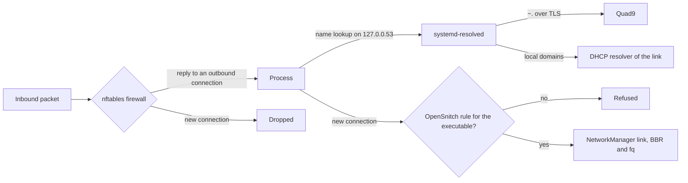

# Network

## Overview

The workstation exposes no service, encrypts its DNS queries, authenticates its clock, and lets an
executable reach the network only when a rule names it. Inbound traffic is filtered by the NixOS
firewall on nftables; outbound traffic is filtered per executable by OpenSnitch.



### Links

NetworkManager manages the connections with iwd as the Wi-Fi backend. Connection profiles and iwd
network secrets are persisted with mode `0700`.

iwd randomises the MAC address per network (`AddressRandomization=network`): each network sees a
different address, derived from its SSID and stable across visits, so captive portals keep
recognising the machine. With the iwd backend, the MAC address options of NetworkManager are
ignored; a profile that pins `mac-address` or `interface-name` no longer matches the randomised
interface.

### DNS

systemd-resolved is the only resolver. Its global servers are the four Quad9 addresses, each with
the TLS name `dns.quad9.net`, in strict DNS-over-TLS mode: a server that cannot complete TLS is not
used, and no query falls back to plain DNS. The routing domain `~.` sends every query to these
global servers by default.

The resolvers announced by DHCP are attached to their link with DNS-over-TLS disabled
(`connection.dns-over-tls = 0` in NetworkManager). They only answer for the search domains of
their own network, such as a router name on a home network. This is split DNS: public names go to
Quad9 over TLS, local names stay on the local network.

`FallbackDNS` is empty, so resolved never falls back to its built-in public resolvers. LLMNR and
multicast DNS are disabled: the machine neither announces itself nor answers name queries on the
local network.

### Inbound firewall

The NixOS firewall runs on the nftables backend. It accepts loopback traffic, replies to
connections the machine opened, and ICMP echo requests. Every other inbound connection is dropped.
No port is open and no SSH server runs. Docker manages its own rules for container networks.

### Congestion control

TCP uses BBR with the fq queueing discipline. BBR paces sending on the measured bottleneck
bandwidth instead of reacting to packet loss, which keeps throughput up on lossy Wi-Fi links.

### Outbound filtering

OpenSnitch intercepts the first packet of every new outbound connection through an NFQUEUE
verdict, finds the process through eBPF, and matches the real executable path read from
`/proc/<pid>/exe`. A wrapper script generated by `makeWrapper` is never matched: the rule names the
binary the wrapper executes. The default action is `deny`. A connection with no rule raises a
prompt in the OpenSnitch UI; without an answer, it is refused once.

Rules come from three sources:

- base rules in `network/opensnitch.nix`: loopback, and the Nix build users that fetch sources
  during builds;
- module rules: each module allows the executables of the service it owns, through
  `custom.network.opensnitch.allowedExecutables` or `allowedExecutablePatterns`;
- user tool rules, grouped in `hosts/hephaestus/opensnitch.nix`.

An exact path is the default, interpolated from the package so it follows every update. A regular
expression is used when the package does not expose the real binary, or when the path changes with
a version, as for programs that update themselves under the home directory.

The NixOS module writes declared rules as symbolic links to the Nix store in
`/var/lib/opensnitch/rules`. A rule accepted with the duration `always` in the UI is written there
as a regular file. The directory is persisted, so UI rules accumulate until they are moved into
the configuration and deleted.

### Time

chrony synchronises the clock with Network Time Security (NTS) against four public servers. NTS
negotiates keys over TLS, then authenticates every NTP packet, so an attacker on the path cannot
shift the clock. Certificate validation needs an approximately correct clock, which a wrong clock
would prevent: `nocerttimecheck 1` lets chrony skip the certificate date check until the clock has
been synchronised once. systemd-timesyncd is disabled by the chrony module, and its OpenSnitch
rule disappears with it.

## How to allow a program through OpenSnitch

1. Find the real executable of the running program.

   ```bash
   readlink /proc/$(pgrep -o <name>)/exe
   ```

   `<name>` is the process name. The OpenSnitch prompt shows the same path.

2. Choose the rule type. Use `allowedExecutables` with the path interpolated from the package. Use
   `allowedExecutablePatterns` when the package does not expose the binary or when the path
   contains a version.
3. Add the rule to the module that owns the service, or to `hosts/hephaestus/opensnitch.nix` for a
   user tool.

   ```nix
   { pkgs, ... }:
   {
     custom.network.opensnitch.allowedExecutables.wget = "${pkgs.wget}/bin/wget";
   }
   ```

4. Apply the configuration, then delete the rule file the UI may have created for the same
   program.

   ```bash
   sudo rm /var/lib/opensnitch/rules/<file>.json
   ```

   `<file>` is the rule name shown by the procedure below.

## How to list the rules accepted outside the configuration

1. List the regular files of the rule directory. Declared rules are symbolic links and are not
   listed.

   ```bash
   sudo find /var/lib/opensnitch/rules -maxdepth 1 -type f -name '*.json'
   ```

2. Read the matched path of a rule in its `operator` field.

   ```bash
   sudo cat /var/lib/opensnitch/rules/<file>.json
   ```

## How to check name resolution

1. Check the global settings and the per-link resolvers.

   ```bash
   resolvectl status
   ```

   The `Global` section shows `+DNSOverTLS`, the Quad9 servers and the domain `~.`. Each link shows
   `-DNSOverTLS` and its DHCP resolver.

2. Resolve a public name and see which server answered.

   ```bash
   resolvectl query nixos.org
   ```

## How to check time synchronisation

1. Check that every source authenticates with NTS.

   ```bash
   chronyc -N authdata
   ```

   The `Mode` column shows `NTS` for each server.

2. Check the offset and the selected source.

   ```bash
   chronyc tracking
   ```

## Reference

### Declared OpenSnitch rules

| Rule | Match | Defined in |
| --- | --- | --- |
| `000-allow-loopback` | Destination network `127.0.0.0/8`, with precedence | `network/opensnitch.nix` |
| `000-allow-loopback6` | Destination `::1`, with precedence | `network/opensnitch.nix` |
| `allow-nix-builders` | User ID `30000` to `30099` | `network/opensnitch.nix` |
| `match-nix` | `nix` binary of any Nix version | `network/opensnitch.nix` |
| `allow-systemd-timesyncd` | Only when timesyncd is enabled | `network/opensnitch.nix` |
| `allow-NetworkManager` | NetworkManager daemon | `network/manager.nix` |
| `allow-systemd-resolved` | resolved daemon | `network/dns.nix` |
| `allow-chronyd` | chrony daemon | `network/time.nix` |
| `match-dockerd` | `dockerd` and `docker-proxy` of any moby version | `virtualisation/docker.nix` |
| `allow-firefox` | Firefox binary | `desktop/firefox.nix` |
| `allow-kioworker` | KDE I/O workers | `desktop/plasma.nix` |
| `allow-plasmashell` | Plasma shell | `desktop/plasma.nix` |
| `allow-fwupdmgr` | Only when fwupd is enabled | `desktop/plasma.nix` |
| `match-discover` | Discover and its notifier | `desktop/plasma.nix` |
| `allow-claude-desktop` | Claude desktop application | `desktop/claude-desktop.nix` |
| `match-claude-code` | Claude Code binary downloaded under `~/.config/Claude` | `desktop/claude-desktop.nix` |
| `allow-git-remote-http`, `allow-ssh`, `allow-curl`, `allow-wget` | Git transports and download tools | `hosts/hephaestus/opensnitch.nix` |
| `allow-python3`, `allow-go` | Language toolchains | `hosts/hephaestus/opensnitch.nix` |
| `allow-terraform`, `match-terraform-providers` | Terraform and the HashiCorp providers it downloads | `hosts/hephaestus/opensnitch.nix` |
| `allow-helm`, `allow-kubectl`, `allow-flux`, `allow-clusterctl`, `allow-kind` | Kubernetes clients | `hosts/hephaestus/opensnitch.nix` |
| `allow-trivy` | Vulnerability scanner | `hosts/hephaestus/opensnitch.nix` |
| `allow-spotify`, `allow-libreoffice`, `match-discord` | Desktop applications | `hosts/hephaestus/opensnitch.nix` |

### OpenSnitch daemon settings

| Setting | Value |
| --- | --- |
| `DefaultAction` | `deny` |
| `DefaultDuration` | `once` |
| `InterceptUnknown` | `false` |
| Rule directory | `/var/lib/opensnitch/rules`, persisted |

### Resolver settings

| Setting | Value |
| --- | --- |
| `DNS` | `9.9.9.9`, `149.112.112.112`, `2620:fe::fe`, `2620:fe::9`, TLS name `dns.quad9.net` |
| `DNSOverTLS` | `true`, strict |
| `Domains` | `~.` |
| `FallbackDNS` | Empty |
| `LLMNR` | `false` |
| `MulticastDNS` | `false` |
| NetworkManager `connection.dns-over-tls` | `0`, link resolvers in plain DNS |

### Time servers

| Server | Operator |
| --- | --- |
| `time.cloudflare.com` | Cloudflare |
| `nts.netnod.se` | Netnod |
| `ptbtime1.ptb.de`, `ptbtime2.ptb.de` | PTB, German national metrology institute |

### Options

| Option | Default | Description |
| --- | --- | --- |
| `custom.network.manager.enable` | `false` | NetworkManager with iwd, MAC randomisation, persisted profiles |
| `custom.network.dns.enable` | `false` | systemd-resolved over TLS with split DNS |
| `custom.network.firewall.enable` | `false` | NixOS firewall on nftables |
| `custom.network.tuning.enable` | `false` | BBR and fq |
| `custom.network.opensnitch.enable` | `false` | OpenSnitch daemon with the declared rules |
| `custom.network.opensnitch.allowedExecutables` | `{ }` | Rule name mapped to an exact executable path |
| `custom.network.opensnitch.allowedExecutablePatterns` | `{ }` | Rule name mapped to a regular expression on the executable path |
| `custom.network.time.enable` | `false` | chrony with NTS |

### Upstream documentation

| Subject | Link |
| --- | --- |
| OpenSnitch rules | <https://github.com/evilsocket/opensnitch/wiki/Rules> |
| `iwd.config` | <https://man.archlinux.org/man/iwd.config.5> |
| `resolved.conf` | <https://www.freedesktop.org/software/systemd/man/latest/resolved.conf.html> |
| chrony | <https://chrony-project.org/documentation.html> |
| BBR | <https://github.com/google/bbr> |
| `services.opensnitch` | <https://search.nixos.org/options?channel=unstable&query=services.opensnitch> |
| `services.resolved` | <https://search.nixos.org/options?channel=unstable&query=services.resolved> |
| `networking.firewall` | <https://search.nixos.org/options?channel=unstable&query=networking.firewall> |
| `networking.wireless.iwd.settings` | <https://search.nixos.org/options?channel=unstable&query=networking.wireless.iwd.settings> |
| `services.chrony` | <https://search.nixos.org/options?channel=unstable&query=services.chrony> |
