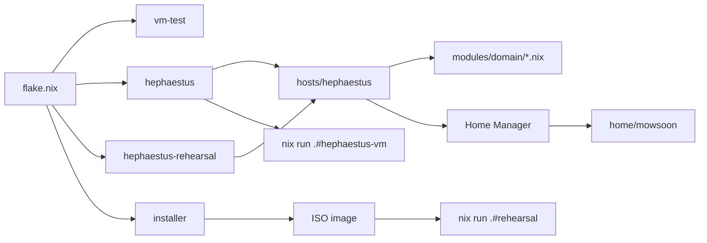

# Architecture overview

## Overview

The repository is a Nix flake pinned to `nixos-unstable`. It builds four NixOS systems and two
helper applications from the same set of modules. `hephaestus` is the physical workstation; the
other systems exist to validate it before a change reaches the hardware.



### Modules and hosts

A module under `modules/<domain>/` describes one capability: Secure Boot, the OpenSnitch firewall,
the NVIDIA driver. It declares an option set under `custom.<name>` with at least an `enable` flag,
and wraps everything it configures in `lib.mkIf cfg.enable`. Importing a module therefore changes
nothing on its own.

A host decides what runs. `hosts/hephaestus/default.nix` imports the modules it needs and sets
their `custom.*` options. Hardware, network and user environment choices are split into
`hardware.nix`, `network.nix` and `home.nix` next to it, each importing the modules of its domain.
Modules are never imported automatically: the import list of a host is the inventory of what that
host can enable.

### Contribution lists

Three options are lists or attribute sets that the module system merges across every module that
sets them. A module that owns a service contributes, in the same file, everything that service
needs outside its own configuration:

| Option | Merged into | Effect |
| --- | --- | --- |
| `custom.persistence.directories` | `environment.persistence."/persist".directories` | The directory survives the root rollback |
| `custom.unfreePackages` | `nixpkgs.config.allowUnfreePredicate` | The package is allowed to build despite its license |
| `custom.network.opensnitch.allowedExecutables` | `services.opensnitch.rules` | The executable may open outbound connections |
| `custom.network.opensnitch.allowedExecutablePatterns` | `services.opensnitch.rules` | Executables whose path matches the expression may open outbound connections |

Disabling a module removes its service, its persisted state, its license exception and its
firewall rule in one step. No central list has to be kept in sync by hand.

### State model

The root filesystem is rolled back to an empty Btrfs subvolume at every cold boot. Everything the
system needs is rebuilt from the Nix store at activation. Only identity, secrets and learned state
are persisted, through the contribution list above. The details are in [Storage](storage.md).

### Private input

The repository is public. Data that reveals personal habits or identifies the hardware, such as
the sites whose third-party scripts uBlock Origin lets through or the serial numbers and partition
UUID of the disks, lives in a separate private repository, `nixos_private`, declared as the
`nixos-private` input with `flake = false`. Nix fetches it as a plain source tree over SSH, and
modules import plain Nix files from it. Each file holds values only, an attribute set without
functions; the public side builds everything derived from them, such as the `/dev/disk/...`
paths. `flake.lock` pins its revision and hash, so only the repository URL and a commit hash are
public.

Fetching the input needs a GitHub SSH key that can read the private repository. The key belongs
to the user, not to root: the flake is evaluated as the user, and only the activation runs with
elevated privileges, as described in [How to apply a change to the
workstation](#how-to-apply-a-change-to-the-workstation).

A fork has no access to this repository. It must provide its own source tree with the same
layout, either by changing the URL of the input or by overriding it at each command, as described
in [How to build without the private repository](#how-to-build-without-the-private-repository).

### Validation chain

A change moves through increasingly realistic machines before it reaches the hardware:

| Stage | What it proves |
| --- | --- |
| `nix flake check` | Formatting (`nixfmt`), lints (`statix`, `deadnix`), the tests, lint (`ruff`) and typing (`mypy`) of the Python packages, and the evaluation of every system |
| `vm-test` | The base user, sudo and Nix settings boot in QEMU |
| `nix run .#hephaestus-vm` | The real `hephaestus` modules boot from the disko layout, with OVMF Secure Boot, an emulated TPM and throwaway keys |
| `nix run .#rehearsal` | The installer image installs `hephaestus` onto a blank virtual NVMe disk |
| `nixos-rebuild test` | The new generation runs on the hardware until the next reboot |

The `hephaestus-vm` variant is the same configuration with overrides in
`virtualisation.vmVariantWithDisko`: NVIDIA and ASUS support are disabled, the Windows volume is a
LUKS stand-in disk, Secure Boot keys are generated and enrolled automatically, and the password
comes from `hosts/vm-test/mowsoon.hash`.

### User environment

Home Manager runs as a NixOS module: the user environment is built and activated with the system
generation, from `home/mowsoon/`. The details are in [User environment](user-environment.md).

## How to add a module

1. Create `modules/<domain>/<name>.nix` with an option set under `custom.<name>`. The disk
   health module is the smallest example of the shape.

   ```nix
   { config, lib, ... }:
   let
     cfg = config.custom.diskHealth;
   in
   {
     options.custom.diskHealth = {
       enable = lib.mkEnableOption "SMART monitoring of every detected disk with desktop notifications";
     };

     config = lib.mkIf cfg.enable {
       services.smartd = {
         enable = true;
         autodetect = true;
         notifications.systembus-notify.enable = true;
       };
     };
   }
   ```

   `<domain>` is one of `core`, `security`, `hardware`, `network`, `desktop` or
   `virtualisation`. `<name>` is the capability in kebab-case.

2. Contribute the state, license exceptions and outbound rules of the service from the same file,
   inside one `custom = { ... };` block when there is more than one.
3. Import the module from the host file of its domain and enable it in the existing `custom` block
   of that file.
4. Track the new file, then validate.

   ```bash
   git add -A
   nix flake check
   ```

## How to apply a change to the workstation

1. Format, track and check the repository.

   ```bash
   nix fmt
   git add -A
   nix flake check
   ```

2. Run the new generation without making it the boot default.

   ```bash
   nixos-rebuild test --flake ~/.config/nixos#hephaestus --elevate sudo
   ```

   Run it without `sudo`: the flake is evaluated and built as the user, whose SSH key fetches the
   private input, and `--elevate sudo` raises privileges only to activate the generation. Under
   `sudo nixos-rebuild`, root evaluates the flake, has no key for the private repository, and
   fails as soon as the pinned revision is missing from the store.

3. Make it the boot default once it works.

   ```bash
   nixos-rebuild switch --flake ~/.config/nixos#hephaestus --elevate sudo
   ```

   A change to the kernel, the initrd, the encrypted container or the NVIDIA driver takes effect
   only after a reboot: use `nixos-rebuild boot`, then reboot.

4. Verify that no reboot is pending. The two paths are identical when the running kernel is the
   one of the active generation.

   ```bash
   readlink /run/booted-system/kernel /run/current-system/kernel
   ```

## How to build without the private repository

1. Create a directory holding every file of the private input layout listed in the Reference
   section. The first file maps sites to the third parties uBlock Origin lets through; an empty
   attribute set `{ }` allows none.

   ```nix
   {
     "<site>" = [ "<host>" ];
   }
   ```

   `<site>` is the registrable domain of a visited site, `<host>` the registrable domain of a
   third party whose scripts and frames that site needs.

   The second file identifies the disks of the target machine.

   ```nix
   {
     systemDisk = "<by-id-name>";
     windowsPartuuid = "<partuuid>";
     windowsDiskSerial = "<serial>";
   }
   ```

   `<by-id-name>` is the name of the system disk under `/dev/disk/by-id`, without the directory.
   `<partuuid>` is the PARTUUID of the encrypted Windows partition, `<serial>` the serial number
   of the Windows disk. `ls -l /dev/disk/by-id /dev/disk/by-partuuid` lists the first two, and
   `lsblk -o NAME,SERIAL` the third.

2. Point the input at that directory, either permanently or for one command.

   ```bash
   nix flake lock --override-input nixos-private path:<directory>
   nix flake check --override-input nixos-private path:<directory> --no-write-lock-file
   ```

   `<directory>` is the absolute path of the directory created in step 1. The first command
   writes the override into `flake.lock`; the second applies it to one command only and leaves
   `flake.lock` untouched. A fork can instead set the `nixos-private` URL in `flake.nix` to its
   own repository.

## Reference

### Flake outputs

| Output | Content |
| --- | --- |
| `nixosConfigurations.vm-test` | Minimal QEMU machine |
| `nixosConfigurations.hephaestus` | Workstation |
| `nixosConfigurations.hephaestus-rehearsal` | Workstation retargeted at the virtual disk of the rehearsal |
| `nixosConfigurations.installer` | Live image used to install the workstation |
| `apps.x86_64-linux.hephaestus-vm` | Boots the workstation VM from a blank firmware and TPM |
| `apps.x86_64-linux.rehearsal` | Boots the installer image against a blank disk |
| `packages.x86_64-linux.rgb-effects` | Keyboard lighting effects daemon, built with its tests |
| `checks.x86_64-linux` | `nixfmt`, `statix`, `deadnix`, `rgb-effects`, `rgb-effects-ruff`, `rgb-effects-mypy` |
| `formatter.x86_64-linux` | `nixfmt-tree` |
| `devShells.x86_64-linux.default` | `nixfmt-tree`, `statix`, `deadnix`, `mkpasswd` |

### Flake inputs

| Input | Role |
| --- | --- |
| `nixpkgs` | Packages and NixOS modules, `nixos-unstable` |
| `disko` | Declarative partitioning, also used to build the VM disk image |
| `impermanence` | Bind mounts of persisted paths into the rolled-back root |
| `lanzaboote` | Signed boot stubs for Secure Boot, pinned to `v1.2.0` |
| `nixos-hardware` | Common AMD, NVIDIA and laptop profiles |
| `home-manager` | User environment as a NixOS module |
| `nixvim` | Editor configuration as Home Manager options |
| `nixos-private` | Private repository over SSH, `flake = false`: personal data imported by modules |

### Private input layout

| File | Imported by | Schema |
| --- | --- | --- |
| `firefox/ublock-allowances.nix` | `modules/desktop/firefox.nix` | Attribute set: site registrable domain to list of third-party registrable domains |
| `hosts/hephaestus/hardware-ids.nix` | `hosts/hephaestus/disko.nix`, `hosts/hephaestus/default.nix` | Attribute set of strings: `systemDisk`, `windowsPartuuid`, `windowsDiskSerial` |

| Attribute | Content | Used as |
| --- | --- | --- |
| `systemDisk` | Name of the system disk under `/dev/disk/by-id` | `/dev/disk/by-id/<name>`, `disko.devices.disk.main.device` |
| `windowsPartuuid` | PARTUUID of the encrypted Windows partition | `/dev/disk/by-partuuid/<uuid>`, `custom.windowsVolume.device` |
| `windowsDiskSerial` | Serial number of the Windows disk | `custom.windowsVolume.diskSerial` |

### Host files of `hephaestus`

| File | Content |
| --- | --- |
| `default.nix` | Core, security, desktop and virtualisation modules; users, locale, boot settings, VM variant |
| `hardware.nix` | Kernel, hardware profiles, NVIDIA, ASUS, audio, peripherals, lighting, power, disk health, Wi-Fi |
| `disko.nix` | Partitions, LUKS container and Btrfs subvolumes |
| `network.nix` | Network modules |
| `home.nix` | Home Manager, login shell, unfree user applications |
| `opensnitch.nix` | Outbound rules of user tools and applications |
| `rehearsal.nix` | Disk override of the rehearsal machine |

### Modules

| Option | Module | Purpose |
| --- | --- | --- |
| `custom.persistence` | `core/persistence.nix` | State kept across root rollbacks |
| `custom.rootRollback` | `core/root-rollback.nix` | Empty root subvolume at every cold boot |
| `custom.snapshots` | `core/snapshots.nix` | snapper timelines |
| `custom.memory` | `core/memory.nix` | zram, swap tuning, systemd-oomd |
| `custom.nixMaintenance` | `core/nix-maintenance.nix` | Build priority, store deduplication, garbage collection |
| `custom.unfreePackages` | `core/unfree.nix` | Allowlist of unfree packages |
| `custom.windowsVolume` | `core/windows-volume.nix` | Read-only access to the BitLocker volume |
| `custom.secureBoot` | `security/secure-boot.nix` | lanzaboote signing |
| `custom.luks` | `security/luks.nix` | TPM2 unlock of the root container |
| `custom.hardening` | `security/hardening.nix` | Kernel and privilege hardening |
| `custom.nvidia` | `hardware/nvidia.nix` | NVIDIA driver |
| `custom.asus` | `hardware/asus.nix` | asusd and battery charge limit |
| `custom.audio` | `hardware/audio.nix` | PipeWire |
| `custom.peripherals` | `hardware/peripherals.nix` | Bluetooth, Logitech receivers, input-remapper |
| `custom.rgb` | `hardware/rgb.nix` | OpenRGB SDK server for the Logitech keyboard |
| `custom.power` | `hardware/power.nix` | Power profiles, delayed hibernation, critical battery |
| `custom.diskHealth` | `hardware/disk-health.nix` | SMART monitoring |
| `custom.mt7921` | `hardware/mt7921.nix` | Patched mt76 Wi-Fi modules |
| `custom.network.manager` | `network/manager.nix` | NetworkManager with iwd |
| `custom.network.dns` | `network/dns.nix` | systemd-resolved over TLS |
| `custom.network.firewall` | `network/firewall.nix` | nftables firewall |
| `custom.network.tuning` | `network/tuning.nix` | BBR and fq |
| `custom.network.opensnitch` | `network/opensnitch.nix` | Outbound firewall |
| `custom.network.time` | `network/time.nix` | chrony with NTS |
| `custom.plasma` | `desktop/plasma.nix` | Plasma 6 and SDDM |
| `custom.firefox` | `desktop/firefox.nix` | Firefox policies, extensions and settings |
| `custom.claudeDesktop` | `desktop/claude-desktop.nix` | Claude desktop application |
| `custom.rgbEffects` | `desktop/rgb-effects.nix` | Lighting effects daemon of the Logitech keyboard, its key reader and notification watcher |
| `custom.docker` | `virtualisation/docker.nix` | Docker daemon |

### Related documents

| Subject | Document |
| --- | --- |
| Boot chain, Secure Boot, TPM | [Boot chain](boot-chain.md) |
| Disks, persistence, memory | [Storage](storage.md) |
| Network and outbound filtering | [Network](network.md) |
| Hardening | [Security](security.md) |
| Hardware support | [Hardware](hardware.md) |
| User environment | [User environment](user-environment.md) |
| Desktop | [Desktop](desktop.md) |
| Installation procedure | [Installation](../operations/installation.md) |
